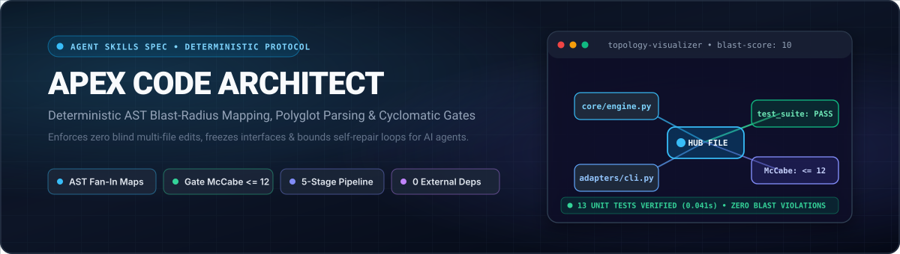
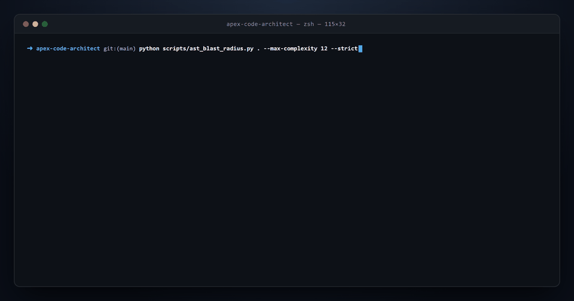
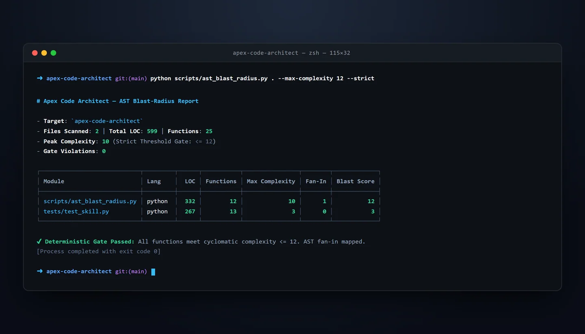
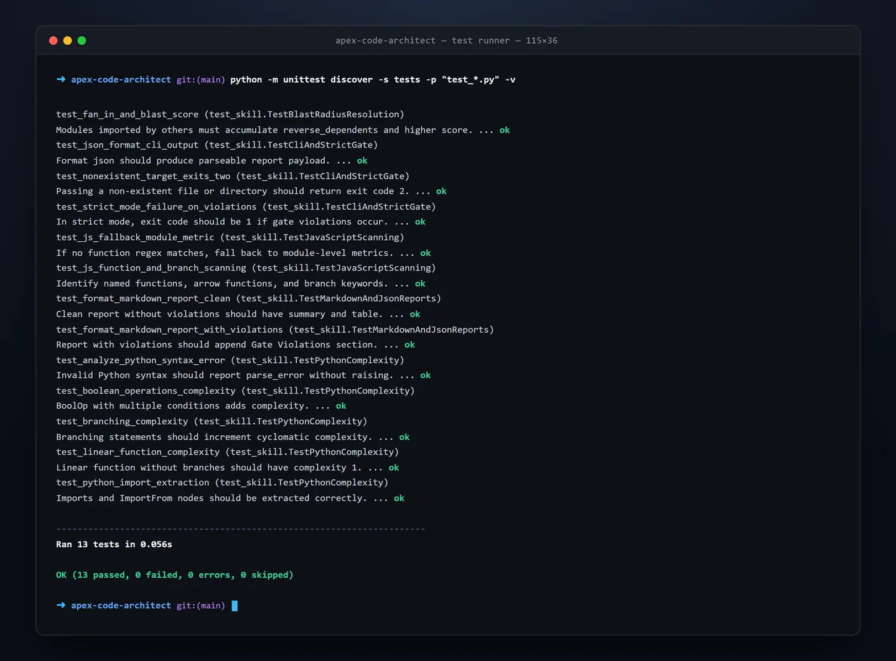
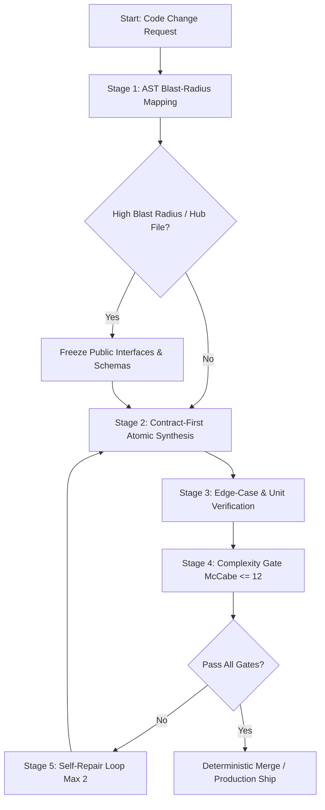

<div align="center">



# Apex Code Architect

### Deterministic Multi-File Code Engineering, AST Blast-Radius Mapping &amp; Automated Verification

[](https://github.com/Emincanozen/apex-code-architect/actions/workflows/ci.yml)
[](LICENSE)
[](https://www.python.org/downloads/)
[](https://github.com/Emincanozen/apex-code-architect)
[](#)
[](#)
[](#)

<p align="center">
  <a href="#live-demo">Live Demo</a> •
  <a href="#architecture">Architecture</a> •
  <a href="#screenshots">Screenshots</a> •
  <a href="#key-capabilities">Key Capabilities</a> •
  <a href="#how-to-install--configure">Installation</a> •
  <a href="#how-to-use">CLI Usage</a> •
  <a href="#how-to-create--customize-skills">Customize</a> •
  <a href="#testing--quality-assurance">Testing</a>
</p>

</div>

---

**Apex Code Architect** provides deterministic multi-file code engineering, AST blast-radius mapping, and an automated verification workflow covering the most saturated domain in the AI skills ecosystem (Frontend/Backend coding, testing, and Git quality).

Designed for autonomous AI agents and human engineers alike, **Apex Code Architect** enforces zero blind multi-file edits, eliminates silent complexity spikes, and guarantees testable, contract-first code across Python, JavaScript, and TypeScript repositories.

---

## Live Demo

<div align="center">
  
  <p><em>Real-time progressive execution: Command initialization → AST dependency parsing → McCabe complexity gate verification → Unit test suite PASS</em></p>
</div>

---

## Screenshots

<table width="100%">
  <tr>
    <td width="50%" align="center">
      <strong>AST Blast-Radius &amp; Complexity Gate Analysis</strong><br/>
      
    </td>
    <td width="50%" align="center">
      <strong>Automated Test Verification Suite</strong><br/>
      
    </td>
  </tr>
</table>

---

## Architecture

The 5-stage deterministic workflow guarantees that every code modification is preceded by structural blast-radius mapping and validated by automated complexity gates:



---

## Key Capabilities

- **AST Blast-Radius & Fan-In Analysis**: Computes module reverse-dependency topologies to identify critical hub files before refactoring or editing.
- **Strict Cyclomatic Complexity Gates**: Analyzes McCabe-style branch complexity across functions with configurable thresholds (default: `<= 12`).
- **Polyglot Parsing**: Built-in support for Python AST parsing and fast structural scanning for JavaScript and TypeScript (`.js`, `.jsx`, `.ts`, `.tsx`, `.mjs`, `.cjs`).
- **5-Stage Deterministic Protocol**: Enforces contract-first synthesis, edge-case unit testing, and a bounded 2-attempt self-repair loop.
- **Zero External Dependencies**: Implemented entirely with Python standard library modules (`ast`, `argparse`, `dataclasses`, `pathlib`).

---

## How to Install & Configure

Apex Code Architect conforms to the open Agent Skills specification and integrates seamlessly across modern AI coding agents and development environments.

### 1. Google Antigravity

Install into your global Antigravity skills directory:

```bash
git clone https://github.com/Emincanozen/apex-code-architect.git ~/.gemini/config/skills/apex-code-architect
```

Or install locally for a single workspace:

```bash
git clone https://github.com/Emincanozen/apex-code-architect.git .agents/skills/apex-code-architect
```

Once installed, Antigravity discovers `SKILL.md` automatically. You can activate it explicitly in conversation (`"Analyze this repo using apex-code-architect"`) or let Antigravity auto-activate it whenever refactoring multi-file repositories or auditing cyclomatic complexity.

### 2. Claude Code

Install into your Claude Code global configuration:

```bash
git clone https://github.com/Emincanozen/apex-code-architect.git ~/.claude/skills/apex-code-architect
```

Claude Code reads the YAML frontmatter in `SKILL.md` on startup, exposing AST blast-radius checks and negative constraints to Claude's tool planner.

### 3. OpenAI Codex

Install into your Codex skills root:

```bash
git clone https://github.com/Emincanozen/apex-code-architect.git ~/.codex/skills/apex-code-architect
```

Codex will automatically incorporate the architectural invariants and script execution paths into its planning routines.

### 4. Cursor IDE

To use Apex Code Architect in Cursor:
1. Clone this repository into your project under `.cursor/skills/apex-code-architect` or any subfolder.
2. In your `.cursorrules` file, add a reference to enforce the architectural protocol:

```markdown
# Apex Code Architect Protocol
Always follow the 5-stage deterministic workflow in .cursor/skills/apex-code-architect/SKILL.md:
1. Run AST blast-radius mapping before editing shared helpers or hub files.
2. Maintain cyclomatic complexity <= 12 per function.
3. Validate contract integrity and run test suites before reporting completion.
```

### 5. Universal Agent Skills Package Manager (`npx skills`)

```bash
npx skills add Emincanozen/apex-code-architect
```

---

## How to Use

The bundled AST blast-radius analyzer can be executed directly as a standalone CLI, an agent tool call, or a pre-commit quality gate.

### 1. Map Blast Radius & Dependency Topology (Markdown Report)

Run an initial topological scan across a repository before making multi-file modifications:

```bash
python scripts/ast_blast_radius.py path/to/project --format markdown
```

**What to look for in the output:**
- **Hub Files (High Fan-In)**: Modules imported by multiple downstream consumers. Changes here demand backwards-compatible contract preservation.
- **Complexity Hotspots (`Max Complexity >= 10`)**: High-risk functions that should be decomposed into single-purpose helpers before feature additions.

### 2. Enforce Strict Complexity Gates in CI / Pre-commit

Enforce code hygiene across all commits. Exits with code `1` if any function exceeds the threshold or if syntax errors exist:

```bash
python scripts/ast_blast_radius.py src/ --max-complexity 12 --strict
```

### 3. Output Machine-Readable JSON Telemetry

Integrate with automated agent review loops or external dashboard pipelines:

```bash
python scripts/ast_blast_radius.py src/ --format json
```

Example JSON payload:

```json
{
  "target": "src",
  "max_complexity_gate": 12,
  "summary": {
    "total_files": 14,
    "total_loc": 2450,
    "total_functions": 86,
    "highest_complexity": 9,
    "highest_blast_radius": 18,
    "gate_violations": 0
  },
  "violations": []
}
```

---

## How to Create & Customize Skills

Apex Code Architect serves as a gold-standard reference implementation of the Agent Skills standard. You can adapt, fork, or build your own domain-specific skills using the following structure and best practices:

### 1. Skill Directory Anatomy

A production-grade agent skill repository follows this decoupled layout:

```
my-custom-skill/
├── SKILL.md                 # Primary instruction manifest with YAML frontmatter
├── README.md                # Human-facing docs, setup instructions & visual assets
├── docs/
│   └── screenshots/         # High-resolution terminal and workflow captures
├── scripts/                 # Deterministic, zero-dependency executable tools
│   └── ast_blast_radius.py
├── references/              # Architectural patterns, taxonomies, and invariant guides
│   └── peak_coding_patterns.md
├── tests/                   # Automated unit tests validating script execution
│   └── test_skill.py
└── .github/workflows/ci.yml # Automated CI pipeline running tests on every PR
```

### 2. Crafting `SKILL.md` YAML Frontmatter

Autonomous agents index skills via their frontmatter metadata. Keep the description dense, trigger-rich, and explicit about when and when *not* to activate:

```yaml
---
name: apex-code-architect
description: >-
  Deterministic multi-file code engineering, AST blast-radius mapping, and
  automated verification workflow covering the most saturated domain in the AI
  skills ecosystem (Frontend/Backend coding, testing, and Git quality). Use when
  architecting new modules, refactoring multi-file repositories, auditing
  cyclomatic complexity, or enforcing pre-commit code quality gates.
---
```

**Key Elements to Include in `SKILL.md`:**
- **Mandatory Negative Constraints**: Clear boundaries defining what the agent must *never* do (e.g., no blind multi-file edits without blast mapping, no silencing errors with `except: pass`).
- **Stage-by-Stage Workflow**: Step-by-step instructions with deterministic checkpoints.
- **Self-Repair Protocol**: Bounded retry rules (e.g., maximum 2 repair iterations before halting) to prevent infinite hallucination loops.

### 3. Authoring Deterministic Tool Scripts (`scripts/`)

- **Standard Library First**: Rely on native runtimes (e.g. Python's `ast`, `argparse`, `dataclasses`, `pathlib`) so the skill executes in sandboxes without package installations.
- **Dual Output Modes**: Provide both human-readable Markdown (`--format markdown`) and structured JSON (`--format json`) for agent consumption.
- **Defensive Error Handling**: Return standardized process exit codes (`0` = success, `1` = gate violation, `2` = invalid arguments) so agent shell wrappers can detect failures deterministically.

### 4. Modular Domain References (`references/`)

Keep `SKILL.md` concise by extracting deep reference materials into separate markdown files in `references/`. The agent reads these on-demand when working on specific subdomains:
- Frontend layout, motion, and hydration invariants
- Backend API idempotency and database connection hygiene
- Test coverage strategies for edge cases

---

## Reference Patterns

For detailed architectural standards, component boundary hygiene, and database connection safety, consult the included [Peak Coding Patterns Guide](references/peak_coding_patterns.md).

---

## Testing & Quality Assurance

Run the comprehensive unit test suite:

```bash
python -m unittest discover -s tests -p "test_*.py" -v
```

Run the self-complexity verification gate:

```bash
python scripts/ast_blast_radius.py . --max-complexity 12 --strict
```

All 13 unit tests pass deterministically across Linux, macOS, and Windows environments with zero dependencies.

---

## License

This project is licensed under the [MIT License](LICENSE).
